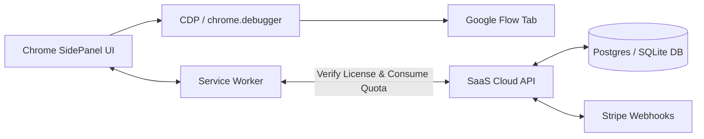

# AUTOFLOW PRO — COMPLETE REVERSE-ENGINEERED MASTER BLUEPRINT
**Source:** Decoded Frame-by-Frame from YouTube Video `q6KugmxYwfQ` (*"I Automated Google Flow Completely — Images & Videos on Autopilot (100% FREE)"* by AIWaliSarkar)

---

## 1. Executive Summary & Exact Architecture

From frame-by-frame analysis of the source video (124 high-resolution extracted frames), the tool is an advanced Chrome Manifest V3 Extension that docks directly as a **Side Panel** (`chrome.sidePanel`) next to Google Flow (`flow.google.com`). 

### Critical Architecture Discovery: Chrome Debugger API
In Frame 0001, Chrome displays:
> **`'AIWaliSarkar AutoFlow' started debugging this browser`** [Cancel]

This confirms the extension uses the **`chrome.debugger` (Chrome DevTools Protocol / CDP)** API:
- Bypasses React synthetic event barriers and anti-bot checks.
- Dispatches trusted hardware-level mouse clicks, keystrokes, and file drops.
- Programmatically injects prompts, reference images, character tags, and clicks "Generate".
- Works reliably even if Google updates internal React class names or button listeners.

---

## 2. Complete User Interface Breakdown

The extension UI is split into 3 main tabs: **`Control`**, **`Settings`**, and **`Logs`**.

### 2.1 Header
- **Profile / Identity:** Circular creator avatar with glowing magenta border, Title: `AIWaliSarkar AutoFlow`.
- **Subtitle:** `Batch videos & images on Google Flow, auto-downloaded.`
- **Action Buttons:** `YouTube` button, `WhatsApp Channel` button.
- **Connection Status:** Green glowing dot + `Connected to Google Flow`.

### 2.2 Top Navigation Tabs
- `Control` (Default active tab)
- `Settings`
- `Logs (99)` (Shows badge count of log entries)

---

### 2.3 CONTROL TAB (The Generation Engine)

#### A. MODE Grid (2x3 Card Matrix)
Six distinct generation workflow modes:
1. **`Text to Video`** — Converts raw prompt script into consecutive video generations.
2. **`Frame to Video`** — Animates start-frame / end-frame image sequences into video.
3. **`Ingredients to Video`** — Uses multiple reference images (characters, objects, environment) as ingredients.
4. **`Text to Image`** — Bulk text-to-image generator using Nano Banana.
5. **`Image to Image`** — Image transformation / editing with prompt.
6. **`Agent Automation`** — Autonomous iterative generation agent.

*Dynamic helper text below the selected card updates depending on mode (e.g., "Generate images from text", "Use images as ingredients (characters, objects, places) inside the video").*

#### B. GENERATION Settings Block
- **`Aspect ratio`** dropdown: `16:9 YouTube`, `9:16 Shorts/TikTok`, `1:1 Square`.
- **`Outputs per prompt`** dropdown: `x1`, `x2`, `x3`, `x4`.
- **`Model`** dropdown:
  - Video: `Omni 1.1 Flash (Omni Flash)`, `Veo 2`, `Veo 3`.
  - Image: `Nano Banana 2.1`.
- **`Image Option / Duration`** dropdown:
  - Image mode: `New image each prompt` vs. `Chain: edit previous image`.
  - Video mode: `Duration / chain`: `10s`, `5s`, `8s`.

#### C. IMAGES Upload & Mapping Block (Visible in Image / Ingredients Mode)
- **Dropzone Area:** Dashed border container:
  > *"Click or drop images here. Name files like the word in your prompt (e.g. lion.png) to auto-pick them."*
- **Thumbnail Strip:** Live image previews (`DRAGON_VILLAGE.jpg`, `ADULT_DRAGON.png`, etc.) with individual `(X)` delete buttons.
- **`Max images per prompt`** dropdown: `1`, `2`, `3`, `4`.
- **`Auto pick by name`** toggle switch: Matches words in the prompt with uploaded filenames automatically!
- **`Remove all images`** button.

#### D. VOICE (SPEAKER) Block (Visible in Video Mode)
- **`Auto voice by name in prompt`** toggle switch.
- **`Default voice`** dropdown (`None`, `Aoede`, `Alnilam`, etc.).
- **`Sync voices from Flow`** button (e.g. "30 voices (built-in)").
- **Context explanation:** *"Voice is picked after the @character, so Character + Voice go together. 'Sync' reads Flow's own voice library (incl. your custom voices)."*

#### E. CHARACTERS Block
- **`Auto @character by name`** toggle switch.
- **`Scan characters from Flow`** button: Reads all saved characters directly from the user's Google Flow project (`@Yuna`, `@Ali`, etc.).
- **Scanned Tag Pills:** Clickable pills (`@Yuna`, `@Ali`) with tooltip: *"Auto mode: added when its name is in the prompt"*.

#### F. PROMPTS Input & Queue Parser
- **Label:** `PROMPTS (Count)`
- **Multiline Textarea:**
  - One prompt per paragraph (leave one empty line between prompts).
  - Special `#tag` syntax: Start a prompt with `#name` to name the downloaded file (e.g. `#shot_01 Cinematic shot...`).
- **`Import .txt`** button.
- **Queue Range Selector:** `Run [ 1 ] to [ N ]` (allows executing a subset of prompts).
- **Parsed Prompt Cards List:**
  - Badge with prompt number (green circular badge `#1`, `#2`, etc.).
  - Prompt text preview.
  - Automatic asset tags: e.g. `1 img: DRAGON_VILLAGE`, `@Yuna, @Ali`.

#### G. Execution Controls
- **`Start AutoFlow`** (Large glowing magenta primary button).
- **`Stop`** button.
- **`Clear`** button.

#### H. Queue & Live Progress Monitor
- Status state: `Queued`, `Running`, `Stopped`, `Completed (X/Y prompts)`.
- Progress bar: Smooth glowing fill tracking percentage.
- Notification popup: *"Started N prompt(s). Keep the Flow tab open."*

---

### 2.4 SETTINGS TAB (Granular Tuning)

1. **SPEED & RETRIES:**
   - **`Prompts at the same time`**: `1`, `2`, `5` (concurrency).
   - **`Agent outputs per prompt`**: `1`, `2`, `4`.
   - **`Delay min (sec)`**: e.g. `0`.
   - **`Delay max (sec)`**: e.g. `20` (randomized jitter delay to prevent rate limits).
   - **`Max retries`**: e.g. `1` to `3`.
   - **`Zoom out Flow while running`**: Toggle switch (shrinks canvas view to keep all generation cards in viewport).

2. **AUTO DOWNLOAD:**
   - **`Video quality`**: `720p (fast)`, `1080p (high)`.
   - **`Image quality`**: `1K (fast)`, `2K`, `4K`.
   - **`Save to folder`**: Text input (e.g. `aiwalisarkar-flow`).
   - **`Auto rename files`**: Toggle switch.
   - **`File naming`**: `Prompt Tag + time code (0-00.png, 0-04.mp4 from #tag)`.
   - Button: `Open Chrome download settings`.

3. **ADVANCED: CUSTOM SELECTORS:**
   - JSON override box for DOM selectors in case Google changes the Flow UI:
     ```json
     {
       "promptTextarea": "textarea",
       "submitButton": "button[type='submit']"
     }
     ```

---

### 2.5 LOGS TAB
- Real-time logging table showing every prompt sent, CDP attachment, DOM detection, download triggers, and error traces.

---

## 3. Commercial SaaS & Multi-User Architecture

To scale this to thousands of users with free vs. paid tier limits:



### Quota & License Tiers:
- **Free Tier:**
  - 10 generations per day.
  - 5 prompts max in batch queue.
  - Standard delay (15s minimum).
- **Pro Tier ($29/mo):**
  - Unlimited generations.
  - 500+ prompts in batch queue.
  - Parallel generation concurrency (up to 5 prompts at the same time).
  - Priority retries and CDP hardware speed.

---

## 4. Directory Assets in this Project

- **`video-analysis/source_video.mp4`**: Full original video (94MB).
- **`video-analysis/frames/`**: 124 extracted frames covering every screen, dropdown, modal, and setting.
- **`AUTOFLOW_MASTER_BLUEPRINT.md`**: This complete technical specification.
