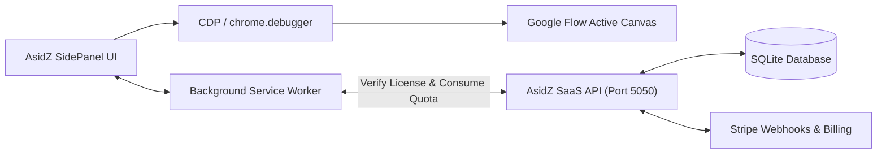

# ASIDZ AUTOFLOW PRO — MASTER SYSTEM SPECIFICATION & ARCHITECTURE
**Product:** AsidZ AutoFlow Pro (Google Flow Enterprise Batch Generator & SaaS Cloud)
**Platform:** Chrome Manifest V3 Side Panel + Chrome DevTools Protocol (CDP) + Cloud SaaS Backend

---

## 1. Executive Summary & Core Architecture

**AsidZ AutoFlow Pro** is a high-performance Chrome Manifest V3 automation extension and SaaS platform that docks as a native Side Panel (`chrome.sidePanel`) inside Google Flow (`flow.google.com`).

### Core Automation Engine: Chrome DevTools Protocol (CDP)
The system leverages the **`chrome.debugger` (Chrome DevTools Protocol / CDP 1.3)** engine:
- Bypasses React synthetic event barriers and anti-automation checks with trusted hardware-level mouse clicks, keystrokes, and file injections.
- Injects multiline prompts, reference assets, character tags, and triggers Google Flow's generation dock directly at the browser rendering engine layer.
- Strictly locked to Google Flow tabs—automatically disabling itself on any other active web page.

---

## 2. User Interface Breakdown

The Side Panel UI consists of 3 primary modules: **`Control`**, **`Settings`**, and **`Logs`**.

### 2.1 Header
- **Branding:** Official AsidZ circular logo with glowing accent border, Title: `AsidZ AutoFlow`.
- **Subtitle:** `Batch videos & images on Google Flow, auto-downloaded.`
- **Navigation:** Portal links to `asidz.com` and AsidZ Support.
- **Connection Status:** Real-time indicator (`Connected to Google Flow`).
- **Quota Monitor:** Dynamic daily generation tracking with 1-click Pro upgrade modal.

### 2.2 Navigation Tabs
- `Control` (Default active workspace)
- `Settings` (Operational tuning, paths, and license activation)
- `Logs` (Real-time CDP debugging and event telemetry)

---

### 2.3 CONTROL TAB (The Generation Engine)

#### A. Generation Modes
1. **`Text to Video`** — Converts batch prompt scripts into sequential cinematic video generations.
2. **`Frame to Video`** — Animates start-frame and end-frame image sequences into video transitions.
3. **`Ingredients to Video`** — Ingests multiple reference images (characters, objects, environment) as video ingredients.
4. **`Text to Image`** — High-throughput text-to-image generator powered by Nano Banana 2.1.
5. **`Image to Image`** — Image transformation, style transfer, and chained prompt iterations.
6. **`Agent Automation`** — Autonomous iterative generation agent inside Google Flow.

#### B. Generation Settings
- **`Aspect ratio`**: `16:9 YouTube`, `9:16 Shorts/TikTok`, `1:1 Square`.
- **`Outputs per prompt`**: `x1`, `x2`, `x3`, `x4`.
- **`Model`**:
  - Video: `Omni 1.1 Flash`, `Veo 2`, `Veo 3`.
  - Image: `Nano Banana 2.1`.
- **`Duration / Chain`**: `10s`, `8s`, `5s` or `Chain: edit previous image`.

#### C. Reference Images Dropzone & Keyword Mapping
- **Asset Dropzone:** Drag and drop reference image files.
- **Auto-Pick Matching:** Automatically matches keywords in prompts with uploaded image filenames (e.g. `mountain.png` matches the word "mountain").
- **Asset Thumbnail Strip:** Dynamic preview chips with delete controls.
- **`Max images per prompt`**: Configurable from `1` to `4`.

#### D. Voice (Speaker) Synchronization
- **`Auto voice by name in prompt`**: Automatically applies voice profiles when voice directives are present.
- **`Default voice`**: Flow voice library selection (`Aoede`, `Alnilam`, `Puck`, `Charon`, `Kore`, `Fenrir`).
- **`Sync voices from Flow`**: Dynamically reads voice presets from the active Google Flow project.

#### E. Character Synchronization
- **Dynamic Character Detection:** Scans saved characters directly from the user's active Google Flow project.
- **Auto-Population Guard:** Only displays characters that exist in the active Flow project; displays a clean empty state when no characters are present.

#### F. Prompt Input & Batch Queue Parser
- **Multiline Textarea:** Supports paragraphs separated by blank lines with `#tag` naming syntax (e.g., `#shot_01 Cinematic aerial view...`).
- **Import Tooling:** 1-click `.txt` file importer.
- **Queue Range Selector:** Customizable `Run [from] to [to]` range selector.
- **Parsed Prompt Cards:** Live queue cards displaying extracted tags, attached reference images, characters, and voice directives.

#### G. Execution Controls & Telemetry
- **`Start AutoFlow`**: Primary execution trigger.
- **`Stop`**: Graceful halt after current CDP step.
- **`Clear`**: Instant prompt queue reset.
- **Queue Progress Bar**: Real-time progress percentage, active prompt readout, and status states (`Idle`, `Running`, `Completed`).

---

### 2.4 SETTINGS TAB

1. **Speed & Retries:**
   - Concurrency: `1` (Safe Sequential), `2` (Parallel Pro), `5` (Turbo Pro).
   - Agent outputs per prompt: `1`, `2`, `4`.
   - Randomized delay jitter (`delayMin` to `delayMax`) to maintain natural pacing.
   - Max retries on generation error.
   - Flow canvas zoom optimization (auto-scales canvas to 90% during batch runs).

2. **Auto Download:**
   - Video quality: `720p (fast)`, `1080p (high)`.
   - Image quality: `1K (fast)`, `2K`, `4K`.
   - Dedicated output subfolder: `asidz-flow/`.
   - Auto-naming format: `#tag` + timecode or slug.

3. **SaaS Cloud Licensing:**
   - Backend API URL configuration (defaults to `http://localhost:5050`).
   - License key activation and instant tier upgrade.

4. **Advanced DOM Overrides:**
   - Configurable JSON selector map for forward compatibility with Google Flow updates.

---

### 2.5 LOGS TAB
- Live telemetry table capturing timestamps, log levels (`INFO`, `CDP`, `WARN`, `ERROR`), and detailed event descriptions.
- Export to `.txt` and clear logs tooling.

---

## 3. Commercial SaaS & Multi-Tier Architecture

### Quota Tiers:
- **Free Tier:**
  - 10 generations per day.
  - 5 prompts maximum per batch queue.
  - Sequential execution.
- **Pro Tier ($29/mo):**
  - Unlimited daily generations.
  - 500+ prompt batch queues.
  - Parallel generation concurrency (up to 5 prompts simultaneously).
  - Priority retry and fast CDP execution.
