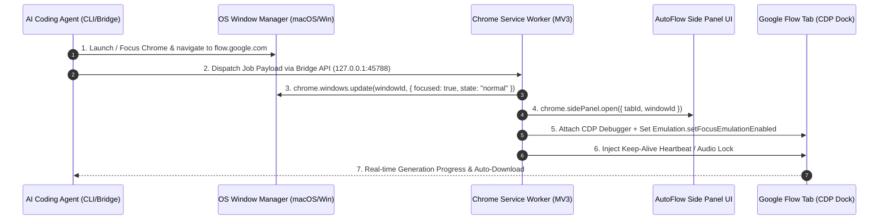
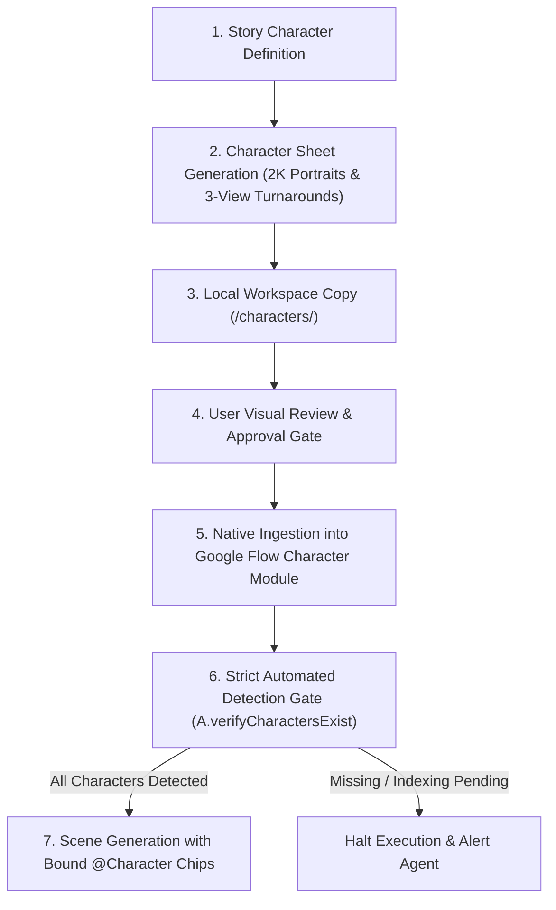
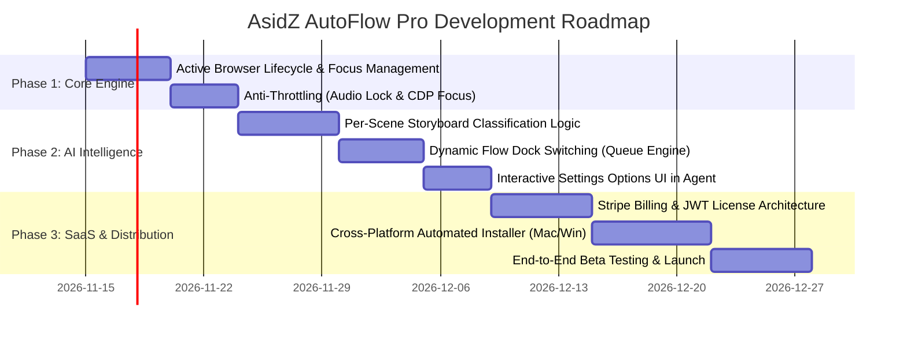

# Detailed Project Report (DPR)
## AsidZ AutoFlow Pro — Next-Generation Commercial SaaS & Automation Engine

**Document Reference:** `DPR-AUTOFLOW-PRO-V3`  
**Platform Scope:** AsidZ AutoFlow Extension, Agent Bridge, AI Storyboard Intelligence, Cloud SaaS  
**Target Environments:** macOS & Windows | Chromium Browsers (Google Chrome, Brave, MS Edge)  
**Status:** Architecture Specification & Development Roadmap

---

## 1. Executive Summary

**AsidZ AutoFlow Pro** is an autonomous AI production bridge that connects conversational AI coding agents (Antigravity, Claude Code, Cursor, Windsurf, ChatGPT) with Google Flow (`flow.google.com`). 

This Detailed Project Report (DPR) outlines the engineering specifications for the three foundational upgrades required to transform the current prototype into an enterprise-grade commercial SaaS product:
1. **Active Browser Orchestration & Anti-Throttling:** Eliminating background execution stalls, auto-launching Chrome, focusing the Google Flow workspace, and revealing the native Side Panel on demand.
2. **Granular Per-Scene AI Intelligence:** Moving from rigid uniform batch settings to an adaptive storyboard engine where the AI agent recommends tailored parameters (mode, media type, model, aspect ratio, duration) per scene with user-friendly confirmation interfaces.
3. **Turnkey Commercial SaaS & Distribution Architecture:** Packaging the extension, background daemon, licensing verification system, and agent skills into an installer with cross-browser support, automated payment renewals, and lifecycle controls.

---

## 2. Pillar I: Browser Lifecycle, Auto-Reveal & Anti-Throttling Architecture

### 2.1 Problem Analysis: Why Background Generation Stalls
* **Chrome Timer Throttling:** Modern Chromium browsers aggressively throttle inactive background tabs. `setTimeout`, `setInterval`, and DOM mutation callbacks drop from sub-10ms resolution to 1000ms+ or are completely suspended when a tab or window is minimized or occluded.
* **App Nap & OS Power Management (macOS):** When Chrome is not the active frontmost application or its window is covered, macOS flags the process for App Nap, starving CPU cycles and stalling DevTools Protocol (CDP) event queues.
* **Missing Side Panel Trigger in Extension Worker:** The Manifest V3 background service worker currently receives bridge events and sends messages to Google Flow tabs, but never issues `chrome.sidePanel.open()` or `chrome.windows.update(..., { focused: true })`.

### 2.2 Engineering Solution & Implementation Plan



#### A. Multi-Layer Auto-Reveal Engine
1. **OS-Level Activation (Bridge Layer):**
   * **macOS:** Bridge executes a native AppleScript directive before socket dispatch:
     ```applescript
     tell application "Google Chrome"
         activate
         set flowFound to false
         repeat with w in windows
             repeat with t in tabs of w
                 if URL of t contains "flow.google.com" then
                     set active tab index of w to (index of t)
                     set index of w to 1
                     set flowFound to true
                     exit repeat
                 end if
             end repeat
             if flowFound then exit repeat
         end repeat
         if not flowFound then
             open location "https://flow.google.com/"
         end if
     end tell
     ```
   * **Windows:** Bridge triggers PowerShell / Win32 API (`SetForegroundWindow`) to restore Chrome from minimized state.

2. **Extension-Level Side Panel Reveal (Service Worker Layer):**
   * In Manifest V3, extensions with `"sidePanel"` and `"tabs"` permissions can open the panel programmatically:
     ```javascript
     async function activateAndRevealPanel(tabId, windowId) {
       await chrome.windows.update(windowId, { focused: true, state: 'normal' });
       if (chrome.sidePanel && chrome.sidePanel.open) {
         await chrome.sidePanel.open({ tabId });
       }
     }
     ```

#### B. Anti-Throttling & Uninterrupted Background Processing
To ensure generation continues even if the user switches to other applications:
1. **CDP Focus Emulation:** Dispatch `Emulation.setFocusEmulationEnabled({ enabled: true })` over `chrome.debugger`. This forces Google Flow's React tree and canvas listeners to treat the page as permanently focused.
2. **Web Locks API / Offscreen Audio Lock:** Utilize an offscreen document (`chrome.offscreen`) generating a 1-second silent looping audio buffer via the Web Audio API. Modern Chromium engines exempt audio-producing tabs from background CPU starvation and timer throttling.
3. **Execution Heartbeat via `chrome.alarms`:** Replace all extension-level `setInterval` polling loops with `chrome.alarms`, which fire reliably regardless of tab visibility.

---

## 3. Pillar II: Granular Scene-by-Scene AI Setting Intelligence

### 3.1 Problem Analysis
Currently, AutoFlow applies uniform batch settings (e.g., all 6 scenes forced to `textToVideo`, `16:9`, `6s`). In narrative production:
* Establishing shots or title cards should be high-resolution still images (`textToImage` via `Nano Banana Pro`).
* Dialogue or character reactions need 4-second video clips.
* Fast action sequences require 6-second or 8-second video clips with multi-character tracking (`Omni 1.1 Flash`).

### 3.2 Engineering Solution: The Intelligent Storyboard Engine

```
User Input (Story / Script / Video Cutlist)
                      │
                      ▼
       ┌───────────────────────────────┐
       │   AI Agent Storyboard Parser  │
       │  - Scene Action Complexity    │
       │  - Pacing & Shot Duration     │
       │  - Character Presence Tracker │
       │  - Composition / Aspect Ratio │
       └──────────────┬────────────────┘
                      │
                      ▼
       ┌───────────────────────────────┐
       │ Interactive Proposal Matrix   │
       │ - [Recommended] vs [Custom]  │
       │ - Scene-by-Scene Table View   │
       └──────────────┬────────────────┘
                      │ (User Confirms / Customizes)
                      ▼
       ┌───────────────────────────────┐
       │ Upgraded Mixed-Job Protocol   │
       │ (JSON Array with Scene Overrides)
       └──────────────┬────────────────┘
                      │
                      ▼
       ┌───────────────────────────────┐
       │ AutoFlow Extension Queue      │
       │ Dynamic Dock Switching on Flow│
       └───────────────────────────────┘
```

#### A. Adaptive Recommendation Rules
The AI agent must evaluate each scene against an analytical rule matrix:

| Scene Trait | Recommended Mode | Recommended Model | Duration / Quality | Rationale |
|---|---|---|---|---|
| Still landscape, title card, architectural background | `textToImage` | `Nano Banana Pro` | `2k` / `4k` | Zero motion needed; still frames offer superior detail and render in seconds. |
| Single character, subtle reaction (nod, smile, glance) | `textToVideo` | `Veo 3.1 - Fast` | `4s` | Minimal camera motion; fast rendering with high character consistency. |
| 2+ Characters interacting (e.g., Aarav + Bruno) | `textToVideo` | `Omni 1.1 Flash` | `6s` – `8s` | Mandatory bypass of Veo 3.1 2-ingredient limit; supports multi-character coherence. |
| Fast dynamic action (chase, sports, vehicle) | `textToVideo` | `Omni 1.1 Flash` | `8s` – `10s` | Longer window needed for motion arc and physical interaction. |
| Sequential continuity (Shot B starts from Shot A's end) | `textToVideo` | Match Shot A | `*-concat` | Chains generation from previous clip's terminal frame. |

#### B. Upgraded Bridge Payload Specification (`scenes[]`)
The bridge protocol will be expanded from flat text strings to a structured scene manifest:

```json
{
  "project": "TheRedBalloon",
  "globalDefaults": {
    "aspectRatio": "16:9",
    "folderName": "asidz-flow",
    "videoQuality": "720",
    "imageQuality": "1k"
  },
  "scenes": [
    {
      "sceneIndex": 1,
      "name": "Scene 1 — Wind takes balloon",
      "mode": "textToVideo",
      "model": "Omni 1.1 Flash",
      "duration": "4s",
      "aspectRatio": "16:9",
      "outputs": 1,
      "characters": ["@Aarav"],
      "prompt": "Cinematic wide shot: @Aarav walks along sidewalk holding bright red balloon..."
    },
    {
      "sceneIndex": 2,
      "name": "Scene 2 — Tree canopy still",
      "mode": "textToImage",
      "imageModel": "Nano Banana Pro",
      "aspectRatio": "16:9",
      "outputs": 1,
      "prompt": "Detailed dramatic low-angle still of bright red balloon caught in autumn tree branches..."
    }
  ]
}
```

#### C. Extension Queue Dynamic Dock Switching
`extension/scripts/flow.js` and `queue.js` will intercept each scene item and reconfigure the Google Flow dock dynamically:
1. Detect mode transition (e.g., from `Video` to `Image`).
2. Dispatch trusted CDP click on the corresponding Google Flow top tab.
3. Switch duration dropdown / model picker per scene before injecting the prompt.

### 3.4 Google Flow Native Character Ingestion, Consistency & Detection Gate Pipeline

#### 3.4.1 Problem Analysis: Why Unregistered `@Character` Mentions Break Continuity
* In Google Flow, typing `@Meera` or `@Chiku` in a prompt only binds character visual latent identity if those characters are registered in Google Flow's Character Registry (`flow-character-tile`).
* If a character is not registered, Flow's autocomplete popover does not display the character chip. Previous versions fell back to typing the name as plain text in the prompt box, resulting in arbitrary character appearances and complete loss of visual continuity across scenes.

#### 3.4.2 The 4-Stage Character Lifecycle Architecture



1. **Character Definition & Turnaround Generation:** For any fresh story, the bridge generates 2K photorealistic studio portraits and 3-view turnaround model sheets (Front, Side, Back) via `textToImage`.
2. **Local Workspace Synchronization:** Assets are automatically renamed (`<Character>_Portrait.jpeg`, `<Character>_Turnaround_3View.jpeg`) and saved into `<project>/characters/`.
3. **Automated Ingestion into Flow Character Module:**
   - **Canvas Tile Conversion:** If the character sheet tile exists on the Flow canvas, the extension activates `moreOptionsButtonInHoverTile` -> `Create Character`, populates the character name, and submits.
   - **Add Menu Ingestion:** Alternatively, opens Add Menu (`+`) -> Characters tab -> `+ Create Character`, inputs the name, and injects base64 image data via `ASIDZ_UPLOAD_FILE_DATA` and `DataTransfer`.
4. **Strict Verification & Detection Gate:**
   - Before any video scenes are queued, `A.verifyCharactersExist(requiredNames)` runs up to 4 scan cycles.
   - The bridge and service worker enforce a strict barrier: if any character is unverified in Flow's registry, batch generation is halted with an explicit directive. Only 100% verified characters are permitted to trigger scene generation with bound `@Character` tokens.

---

## 4. Pillar III: Commercial SaaS Packaging, Distribution & Licensing Architecture

### 4.1 Comparative Analysis: Distribution Architecture Options

We evaluated three potential deployment architectures for commercializing AsidZ AutoFlow:

| Architecture | Description | Pros | Cons | Verdict |
|---|---|---|---|---|
| **Option A: Chrome Web Store + Native Bridge Installer** | Extension distributed via Chrome Web Store (Public or Unlisted); lightweight OS installer configures the local bridge daemon and agent skills. | • Fastest time to market<br>• Chrome auto-updates extension<br>• Low distribution friction | • Requires users to run a 1-step terminal command or installer package for the bridge | **Recommended Phase 1 (MVP)** |
| **Option B: Unified Desktop App (Electron / Tauri Wrapper)** | Single desktop client bundle containing embedded bridge daemon, license manager, and automated extension injector. | • 1-click install (`.dmg` / `.exe`)<br>• Professional consumer UX<br>• Centralized subscription dashboard | • Higher binary size (~80MB for Electron, ~15MB for Tauri)<br>• Requires code signing certificates (Apple Developer ID, Microsoft Authenticode) | **Recommended Phase 2 (Enterprise)** |
| **Option C: Pure Sideloaded Extension via System Policy** | Desktop installer writes directly into Chrome's External Extensions directory (`/Library/Application Support/Google/Chrome/External Extensions/`). | • No Chrome Web Store review dependency | • Chrome frequently flags sideloaded unpacked extensions with security warnings<br>• High support burden | **Not Recommended** |

### 4.2 Browser Compatibility Reality Check
* **Chromium (Chrome, Brave, Edge, Arc):** **100% Fully Supported.** Native support for Chrome DevTools Protocol (`chrome.debugger`), Manifest V3 `chrome.sidePanel`, and `chrome.downloads`.
* **Safari:** **Not Recommended.** Safari WebExtensions do not support Chrome DevTools Protocol (CDP) or native side panels. Porting would require a ground-up rewrite using WebKit WebDriver or brittle synthetic DOM injection.
* **Firefox:** **Secondary Priority.** Google Flow is heavily optimized for Chromium rendering engines; Firefox lacks CDP native debugger bindings.
* **Strategic Decision:** Anchor the commercial product on **Chromium browsers** (representing >85% of creator and AI developer workstations).

### 4.3 Subscription Licensing & Protection Architecture

```mermaid
flowchart TD
    User([User / Creator]) -->|1. Monthly Payment| Stripe[Stripe Checkout / LemonSqueezy]
    Stripe -->|2. Webhook Event: customer.subscription.created| CloudAPI[AsidZ SaaS Backend API]
    CloudAPI -->|3. Issues Signed JWT License Key| User
    User -->|4. Inputs License in App / Installer| Bridge[Local AutoFlow Bridge]
    Bridge -->|5. Heartbeat & Token Check| CloudAPI
    CloudAPI -->>|6. Valid: Active Pro Status| Extension[Chrome Extension & Side Panel]
    CloudAPI -->>|7. Expired: Lock Automation Dock| Extension
```

#### A. Billing & Metering Engine
* **Payment Gateways:** Stripe Billing or LemonSqueezy (LemonSqueezy acts as Merchant of Record, handling global VAT/GST sales compliance automatically).
* **Subscription Tiers:**
  * **Free Starter:** 5 generations/day, standard 720p downloads, watermark preservation.
  * **Pro Creator ($29/month):** Unlimited generations, 1080p/4K upscaling, multi-character auto-detection, priority batching.
  * **Studio Agency ($79/month):** Multi-seat concurrency, custom webhook hooks, direct NLE timeline exports.

#### B. Cryptographic License Verification
1. **Signed Token System:** Upon successful checkout, the backend generates an asymmetric cryptographically signed license token (ed25519 or RSA-256) containing:
   * `licenseKey`: e.g. `PRO-AUTOMA-XXXX-XXXX`
   * `expiresAt`: ISO timestamp (current billing cycle end + 3 days grace period)
   * `tier`: `PRO`
   * `machineFingerprint`: Hash of MAC address + OS serial number (prevents unauthorized multi-machine sharing)
2. **Offline Resilience (72-Hour Grace Period):**
   * The extension and bridge cache the cryptographically verified token locally in `chrome.storage.local`.
   * The system validates against the local token without requiring an active internet connection on every single prompt submission.
   * If offline for >72 hours, a prompt requests a reconnection heartbeat.
3. **Automated Deprovisioning:**
   * If a subscription payment fails (`invoice.payment_failed`) or is cancelled:
   * Webhook immediately marks the license status as `EXPIRED` in the database.
   * On the next heartbeat check (or when grace period lapses), the extension locks the `#startQueue` button and displays an in-app renewal modal.
   * Bridge rejects CLI dispatches with HTTP 402 (`Subscription Inactive`).

### 4.4 Automated 1-Click Installer Specification

To deliver a commercial "download-and-go" experience:

#### Mac Deployment Package (`AsidZ-AutoFlow-Setup.pkg` or `install.sh`)
1. Detects installed Chromium browsers (Google Chrome, Brave, Microsoft Edge).
2. Deploys the background bridge daemon as a managed `launchd` service:
   * Path: `~/Library/LaunchAgents/com.asidz.autoflow.bridge.plist`
   * Configured with `KeepAlive: true` and `RunAtLoad: true`.
3. Auto-configures AI agent skills:
   * Symlinks or copies `AGENT_BRIDGE.md` / `SKILL.md` directly into:
     * Antigravity: `~/.gemini/antigravity/skills/asidz-autoflow/`
     * Claude Code / Desktop: `~/.claude/skills/asidz-autoflow/`
     * Cursor / Windsurf: `~/.cursor/rules/asidz-autoflow.mdc`
4. Registers the native MCP server in `claude_desktop_config.json` automatically.
5. Provides a one-line uninstaller:
   ```bash
   curl -fsSL https://asidz.com/uninstall | bash
   ```
   * Unloads `launchd` daemon, deletes bridge binaries, removes agent skill symlinks, and cleans temporary files.

#### Windows Deployment Package (`AsidZ-AutoFlow-Setup.msi`)
1. Installs background bridge as a Windows Scheduled Task / Windows Background Service.
2. Updates registry path and configures Cursor/Claude config files in `%APPDATA%`.
3. Standard Windows "Add/Remove Programs" clean uninstallation support.

---

## 5. Development Roadmap & Milestones



### Milestone Deliverables

* **Milestone 1 (Browser Lifecycle & Anti-Throttling):**
  * Auto-launch and focus of Chrome on job receipt.
  * Side panel automatic expansion via `chrome.sidePanel.open()`.
  * Zero-throttling verification during background/minimized states.
* **Milestone 2 (Storyboard Intelligence & Mixed-Media Engine):**
  * AI agent analyzes raw storyboards and presents scene-by-scene recommendations (`Image` vs `Video`, durations, models).
  * Dynamic queue engine successfully toggles Flow tabs mid-batch.
* **Milestone 3 (Commercial SaaS & Turnkey Installer):**
  * Functional Stripe subscription checkout with automated key generation.
  * 1-click macOS `.pkg` / shell installer that configures bridge, agent skills, and licenses.
  * Verified uninstaller removing all system footprints cleanly.

---

## 6. Conclusion & Immediate Next Steps

The technical foundation built across `asidz-agent-bridge.py`, the Manifest V3 extension, and `saas-backend/server.js` provides 70% of the core functionality. By executing the enhancements detailed in this DPR:
1. Generation will become completely visual, focused, and immune to OS background throttling.
2. The AI coding agent will evolve into an intelligent director that personalizes every scene.
3. The platform will be primed for commercial monetization as a turnkey subscription product for digital creators and video production studios worldwide.
